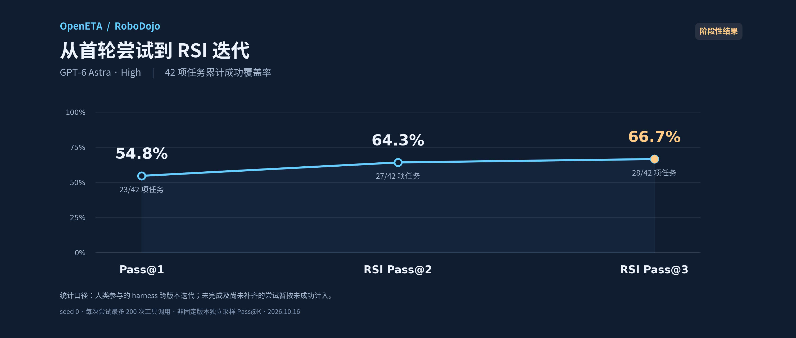

# RoboDojo: interim human-assisted harness RSI results

Snapshot: **2026-10-16**, 42 tasks, GPT-6 Astra at **high** reasoning effort.

| Attempt budget | Tasks with an official success within the budget | Provisional coverage |
| --- | ---: | ---: |
| Pass@1 (v108 baseline) | 23 / 42 | 54.8% |
| RSI Pass@2 | 27 / 42 | 64.3% |
| RSI Pass@3 | 28 / 42 | 66.7% |

## What these numbers mean

This is a retrospective, **human-assisted, cross-version harness RSI** experiment,
starting from v108 and following each task's actual attempts through v109, v111
and v112. Count a task as covered when at least one of its first n actual attempts
has an official success. Successful tasks need not be repeated n times.

The curve is **interim cumulative coverage, not a final RSI Pass@n estimate**:
unfinished attempts and tasks without all n attempts contribute no success to
this chart. At this snapshot, 28 tasks passed within three attempts, eight had
three ended attempts without success, and six still needed attempts. The v112
queue had ended 14 of its 15 tasks, with one official success; sweep_blocks was
still running. Queue completion and filling every task's n-attempt budget are
different things. The original v108 result remains 23/42.

- Every task attempt uses seed 0, a fresh model session and at most 200 tool
  calls. The reported protocol has no whole-episode wall-clock or native-action
  limit. It is not directly comparable to benchmark protocols with other budgets
  or multiple seeds.
- Human diagnosis and approvals, versioned task-wording corrections, and reviewed
  historical experience are part of the process. Original task wording is retained
  with supplements; native reward predicates are unchanged. This is not fully
  autonomous RSI, an independent fixed-version pass@k evaluation, or a causal
  estimate of the benefit of any particular fix.
- Infrastructure/Host interruptions after real execution occupy an attempt.
  Zero-action startup failures are listed separately (four in this snapshot).
  Missing token accounting is unknown, not zero.
- `check_task_completion` provides restricted semantic feedback from the latest
  native evaluation. It withholds object coordinates, numerical tolerances and
  reward values, but is still additional, privileged semantic feedback. It is not
  equivalent to a vision-only observation setting.
- Execution logs identify Astra/high. Use of the same model/effort for development
  is based on the operator's account, not an independently audited identity log.

The [sanitized per-task attempt ledger](assets/robodojo-rsi-progress-20261016.json)
contains the outcomes used to calculate this figure. Private logs, access tokens,
deployment addresses and raw model transcripts are not included.

## Release

The [robodojo-v112 branch](https://github.com/OpenMOSS/OpenETA/tree/robodojo-v112)
contains the released harness and its
[setup guide](https://github.com/OpenMOSS/OpenETA/blob/robodojo-v112/docs/robodojo-v112.md).
The chart summarizes the version lineage; it is **not** a 66.7% v112-only result.
